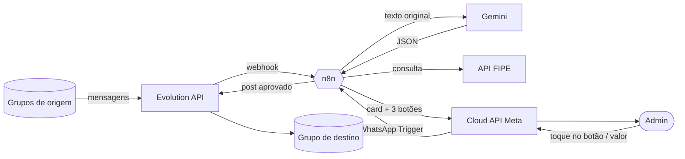
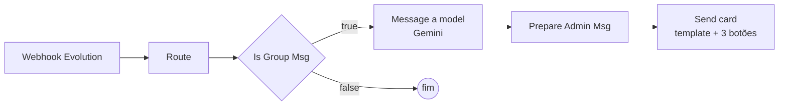
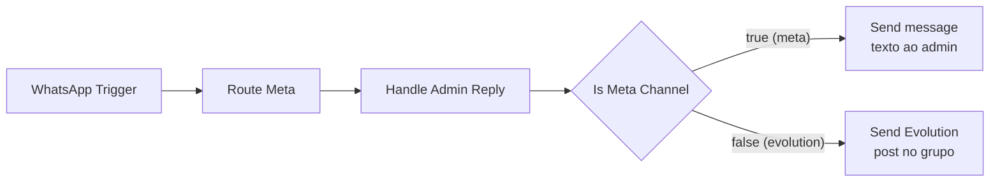
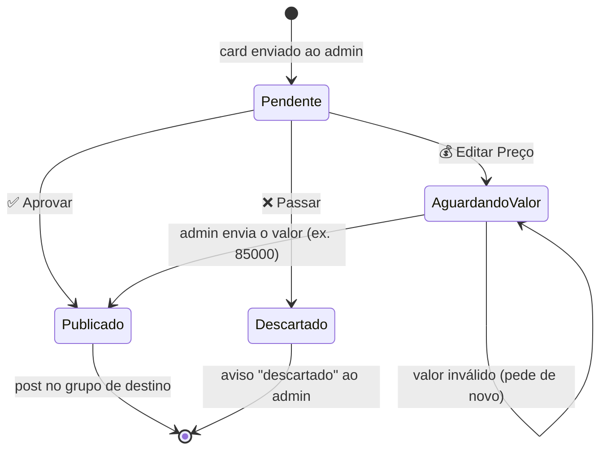
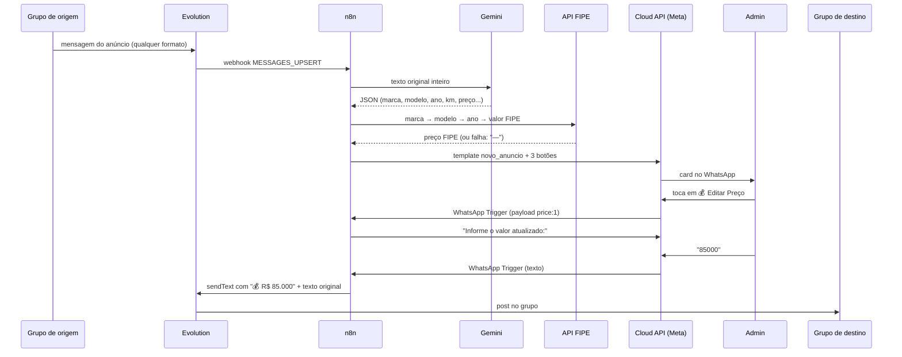

# whatsapp-triagem-ai

Sistema de IA para leitura, triagem e publicação automática de anúncios de veículos em grupos de repasse via WhatsApp.

Um número lê os grupos de repasse (Evolution API). O Gemini interpreta cada mensagem e devolve um JSON. O sistema monta um card com FIPE, região e link Webmotors e manda ao admin pela API oficial da Meta, com 3 botões. O admin aprova, edita o preço ou passa, e o anúncio aprovado é publicado no grupo de destino.

## Sumário
1. [Visão geral](#visão-geral)
2. [Fluxo do n8n](#fluxo-do-n8n)
3. [Cada bloco em detalhe](#cada-bloco-em-detalhe)
4. [Card enviado ao admin](#card-enviado-ao-admin)
5. [Template `novo_anuncio`](#template-novo_anuncio-criar-e-aprovar-na-meta)
6. [Estado e dados](#estado-e-dados)
7. [Estrutura do repositório](#estrutura-do-repositório)
8. [Testes](#testes)
9. [Limitações](#limitações)
10. [Como executar](#como-executar)

---

## Visão geral

O projeto usa **dois canais de WhatsApp** de propósito:

| Canal | Para quê | Por quê |
|---|---|---|
| **Evolution API** (Baileys, não-oficial) | Ler os grupos de origem e postar no grupo de destino | A API oficial da Meta não entra em grupos que já existem |
| **Cloud API da Meta** (oficial) | Conversa 1:1 com o admin (card, botões, avisos) | Sem risco de ban nessa parte |



## Fluxo do n8n

O arquivo `n8n/workflow.json` é **um workflow com 2 cadeias** (cada uma começa em um gatilho) e 12 nós.

### Cadeia 1: anúncio no grupo → card para o admin



### Cadeia 2: resposta do admin → grupo de destino



### Os 3 botões do card



### Sequência completa (exemplo: Editar Preço)



## Cada bloco em detalhe

### Cadeia 1

| Nó | Tipo | O que faz |
|---|---|---|
| **Webhook Evolution** | Webhook (POST `/evolution-wa`) | Recebe o evento `MESSAGES_UPSERT` da Evolution API a cada mensagem. |
| **Route** | Code | Lê o payload e deixa passar só mensagens **de texto** de **grupos de origem** que não foram enviadas por você. Extrai o texto de `conversation`, `extendedTextMessage` ou da legenda de imagem/vídeo. Guarda também quem enviou (`sender`, `pushName`) e o horário (`ts`). **Contém o bloco `CONFIG`** (grupos, admin, Phone Number ID etc.). |
| **Is Group Msg** | IF | Confere `type == group_msg`. O ramo *false* termina sem fazer nada. |
| **Message a model** | Google Gemini (nativo) | Recebe o **texto original inteiro**, em qualquer formatação, e só interpreta: decide se é anúncio e associa cada dado ao seu valor, devolvendo **JSON**. Não inventa preço, km nem ano (usa `null`). |
| **Prepare Admin Msg** | Code | Lê o JSON do Gemini e monta as 15 variáveis do template (ver abaixo). Consulta a FIPE, calcula região e "há X dias", gera o link Webmotors e guarda o anúncio como **pendente**. Não faz parsing de texto livre: só formata o JSON. |
| **Send card** | HTTP Request (Graph API) | Envia ao admin o template `novo_anuncio` com 3 botões *quick-reply*. Cada botão leva o id do anúncio no payload (`approve:1`, `price:1`, `skip:1`). É HTTP porque o nó nativo do WhatsApp só envia texto simples. |

**JSON devolvido pelo Gemini:**

| Campo | Exemplo | Uso no card |
|---|---|---|
| `is_ad` | `true` | `false` → mensagem descartada |
| `nome_carro` | `Honda Civic EXL` | Título |
| `marca` / `modelo` | `Honda` / `Civic` | Consulta FIPE e link Webmotors |
| `ano` | `2018` | Título e FIPE |
| `km` | `50000` | Quilometragem |
| `preco` | `80000` | Pedido |
| `ipva_pago` | `true`/`false`/`null` | "IPVA pago" / "não pago" / "não informado" |
| `revisoes_em_dia` | `true`/`false`/`null` | Linha de revisões |
| `combustivel` + `combustivel_deduzido` | `Flex`, `true` | "Flex (deduzido)" |
| `cidade_uf` | `Campinas/SP` | Região |
| `assumido` | `["Pneus 80%", ...]` | Linha "Assumido" |
| `loja` | `Loja Exemplo` | 📍 |
| `contato_nome` / `contato_telefone` | `João` / `19988887777` | 👤 |

**Funções dentro do Prepare Admin Msg:**

| Função | O que faz |
|---|---|
| `parseGemini` | Lê a resposta do Gemini em qualquer formato (nó nativo, API crua, objeto pronto, ou JSON entre cercas \`\`\`json). Devolve `null` se não der para ler. |
| `toNumber` / `fmtNum` | Convertem `80 mil`, `R$ 80.000,00`, `50k`, `79,9 mil` em número e formatam em `80.000`. |
| `fipeLookup` | Consulta a API FIPE (Parallelum): marca → modelo → ano → preço. Faz match aproximado de nomes (ignora acento e caixa; escolhe o nome mais curto que contém todos os termos) e escolhe o ano com o combustível certo. Guarda a lista de marcas em cache. **Qualquer falha devolve `null` e o card sai com `—`**; nunca derruba o fluxo. |
| `regionLabel` | Descobre a região pela UF de `cidade_uf`; se faltar, pelo DDD do telefone. Ex.: `Sudeste (SP)`. |
| `norm` / `slug` | Normalizam texto e geram o slug do link (`Gol G6` → `gol-g6`). |
| `prepareMain` | Orquestra tudo: gera o id do anúncio, monta as variáveis, guarda o pendente e devolve o item para o Send card. |

### Cadeia 2

| Nó | Tipo | O que faz |
|---|---|---|
| **WhatsApp Trigger** | WhatsApp Trigger (nativo) | Recebe as mensagens do admin pela Cloud API. Registra e verifica o webhook na Meta sozinho ao ativar o workflow. |
| **Route Meta** | Code | Aceita só mensagens **do número do admin**. Reconhece três tipos: texto, toque em botão de template e botão interativo. Entrega `text` + `payload`. Ignora mídia e notificações de status (entregue/lida). **Mesmo bloco `CONFIG` do Route.** |
| **Handle Admin Reply** | Code | Decide o que fazer com o que o admin mandou (ver tabela abaixo). Devolve itens com `channel: 'evolution'` (post no grupo) ou `channel: 'meta'` (aviso ao admin). |
| **Is Meta Channel** | IF | Separa os itens por canal: `meta` vai para o **Send message**, `evolution` vai para o **Send Evolution**. |
| **Send message** | WhatsApp (nativo) | Envia texto ao admin (ex.: "Informe o valor atualizado:"). |
| **Send Evolution** | HTTP Request | Posta o anúncio no grupo de destino via Evolution (`/message/sendText`), 1 por vez com intervalo de 3 s. |

**O que o Handle Admin Reply faz com cada entrada:**

| Entrada do admin | Resultado |
|---|---|
| Botão ✅ **Aprovar** (`approve:<id>`) | Posta o texto original no grupo. Sem mensagem de confirmação ao admin. |
| Botão ❌ **Passar** (`skip:<id>`) | Descarta o pendente e avisa "#id descartado". |
| Botão 💰 **Editar Preço** (`price:<id>`) | Responde "Informe o valor atualizado:" e passa a aguardar o valor. |
| Texto com valor, aguardando (`85000`, `R$ 82.500`, `90k`, `78 mil`) | Posta no grupo com `💰 R$ <novo>` na primeira linha, seguido do texto original. |
| Texto sem valor, aguardando | Responde "Não entendi o valor. Informe o valor atualizado:" e continua aguardando. |
| Fallback: `ok 3`, `nao 3`, `editar 3 novo texto` | Aprova, descarta ou posta um texto novo do anúncio 3. |
| Anúncio inexistente ou já tratado | "Anúncio #id não encontrado (já tratado?)". |
| Qualquer outro texto | Ignorado. |

## Card enviado ao admin

Exemplo do que chega no WhatsApp do admin:

```
🚗 Honda Civic EXL, 2018 · 50.000 km
💰 Pedido: R$ 80.000
📊 FIPE: R$ 75.000
✅ IPVA pago · Revisões em dia
⛽ Flex (deduzido)
📌 Sudeste (SP)
⚠️ Assumido: Pneus 80%, Manual + Chave Reserva
🔗 Anúncios do modelo: https://www.webmotors.com.br/carros/estoque/honda/civic

📍 Loja Exemplo
👤 João (19988887777)
⏱️ há 3 dias

[ ✅ Aprovar ]  [ 💰 Editar Preço ]  [ ❌ Passar ]
```

Dado que não veio no anúncio aparece como `—`.

## Template `novo_anuncio` (criar e aprovar na Meta)

WhatsApp Manager → Modelos de mensagem → idioma **pt_BR**, categoria **Utility**, nome `novo_anuncio`. Corpo, com 15 variáveis de uma linha:

```
🚗 {{1}}, {{2}} · {{3}} km
💰 Pedido: R$ {{4}}
📊 FIPE: R$ {{5}}
✅ IPVA {{6}} · {{7}}
⛽ {{8}}
📌 {{9}}
⚠️ Assumido: {{10}}
🔗 Anúncios do modelo: {{11}}

📍 {{12}}
👤 {{13}} ({{14}})
⏱️ há {{15}} dias
```

Botões **Resposta rápida**, nesta ordem: `✅ Aprovar`, `💰 Editar Preço`, `❌ Passar`. O n8n envia o payload `approve:<id>` / `price:<id>` / `skip:<id>` em cada botão.

Regras da Meta que o código respeita: variáveis sem quebra de linha, tab ou 4+ espaços seguidos; campo vazio vira `—`.

## Estado e dados

- **Pendentes**: guardados no *static data* do workflow (`pending`, `counter`, `awaiting`, `fipeBrands`). Por isso as duas cadeias ficam no mesmo workflow: elas compartilham esse estado. O static data só persiste com o workflow **ativo (Publish)**.
- **Banco**: o Postgres e o Redis do `docker-compose.yml` são **internos da Evolution API** (guardam a sessão do WhatsApp para não pedir o QR a cada restart). O fluxo do n8n não usa banco.
- **Segredos**: `.env` (ignorado pelo git) e credenciais do n8n. Nada de chave no código.

## Estrutura do repositório

```
├── docker-compose.yml        Evolution API + Postgres + Redis
├── .env.example              EVOLUTION_API_KEY, POSTGRES_PASSWORD, GEMINI_API_KEY
├── n8n/
│   ├── build-workflow.mjs    gera workflow.json
│   ├── code.mjs              código dos nós Code + prompt do Gemini
│   ├── n8n-export.json       export do n8n (base dos nós nativos)
│   └── workflow.json         GERADO: é o que se importa no n8n
├── tests/
│   ├── helpers/n8n.mjs       executor de nós e do grafo, fixtures
│   ├── nodes/*.test.mjs      um arquivo por bloco do workflow
│   ├── workflow-structure.test.mjs
│   └── e2e-flow.test.mjs     fluxo completo
├── .github/workflows/ci.yml  roda `npm test` no push/PR
└── package.json              scripts build e test
```

> `n8n/workflow.json` é gerado. Para mudar o fluxo, edite `n8n/code.mjs` ou `n8n/build-workflow.mjs` e rode `npm run build`. Se mudar os nós nativos (Gemini/WhatsApp) no n8n, exporte de novo para `n8n/n8n-export.json`.

## Testes

```bash
npm test
```

Rebuilda o `workflow.json` e roda tudo (Node 22+). Gemini e FIPE são simulados, então não precisa de internet nem de chaves.

- `tests/nodes/`: um arquivo por bloco, com vários cenários cada.
- `tests/workflow-structure.test.mjs`: nós, conexões e consistência do grafo.
- `tests/e2e-flow.test.mjs`: fluxo completo (anúncio → card, aprovar, editar preço com valor válido/inválido, passar, remetente que não é admin, FIPE fora do ar).

## Limitações

- O envio do card depende do template aprovado pela Meta (pode levar horas; categoria Marketing tem custo maior).
- FIPE: match aproximado por nome; sem correspondência o campo fica `—`. A API Parallelum sem token permite ~500 consultas/dia (`fipeToken` no `CONFIG` aumenta o limite).
- O link Webmotors é a busca do modelo (`/carros/estoque/<marca>/<modelo>`), não um anúncio específico.
- Só texto e legenda. Fotos não são repassadas.
- Pendentes ficam no static data do n8n, sem expiração.
- A Evolution API é não-oficial: use chip dedicado (risco de ban).

---

## Como executar

### Pré-requisitos
- Docker Desktop
- Node 22+ (para gerar o workflow e rodar os testes)
- Conta Meta Developers com app WhatsApp, número **diferente** do chip da Evolution, e o template `novo_anuncio` aprovado
- Chave da API do Gemini
- URL pública HTTPS para o n8n receber o webhook da Meta (ex.: `cloudflared` ou `ngrok` apontando para `localhost:5678`)

### 1. Configurar o `.env`

```bash
copy .env.example .env
```

Preencha:

```
EVOLUTION_API_KEY=<string longa que você inventa; protege a API local>
POSTGRES_PASSWORD=<senha interna do container>
GEMINI_API_KEY=<chave do Gemini>
```

### 2. Subir a Evolution API (Docker)

```bash
docker compose up -d
docker compose ps
```

A Evolution fica em http://localhost:8080 (painel: http://localhost:8080/manager).

### 3. Subir o n8n (Docker)

O `docker-compose.yml` não inclui o n8n. Suba assim, com a URL pública no `WEBHOOK_URL`:

```bash
docker run -d --name n8n -p 5678:5678 -v n8n_data:/home/node/.n8n --add-host=host.docker.internal:host-gateway -e WEBHOOK_URL=https://SUA-URL-PUBLICA/ docker.n8n.io/n8nio/n8n
```

Abra http://localhost:5678 e crie a conta local. Se o n8n já roda na sua máquina, pule este passo.

### 4. Conectar o número da Evolution (QR code)

Use um chip dedicado. Com `EVOLUTION_API_KEY` definida no terminal:

```bash
curl -X POST http://localhost:8080/instance/create -H "apikey: $EVOLUTION_API_KEY" -H "Content-Type: application/json" -d '{"instanceName":"triagem","qrcode":true,"integration":"WHATSAPP-BAILEYS"}'
```

Abra http://localhost:8080/manager e escaneie o QR no celular (WhatsApp → Aparelhos conectados).

### 5. Apontar o webhook da Evolution para o n8n

```bash
curl -X POST http://localhost:8080/webhook/set/triagem -H "apikey: $EVOLUTION_API_KEY" -H "Content-Type: application/json" -d '{"webhook":{"enabled":true,"url":"http://host.docker.internal:5678/webhook/evolution-wa","events":["MESSAGES_UPSERT"]}}'
```

Para listar os grupos e pegar os ids (`...@g.us`) de origem e destino:

```bash
curl "http://localhost:8080/group/fetchAllGroups/triagem?getParticipants=false" -H "apikey: $EVOLUTION_API_KEY"
```

### 6. Gerar e importar o workflow

Sempre que mudar `n8n/code.mjs` ou `n8n/build-workflow.mjs`, **atualize o workflow** com:

```bash
npm run build
```

Isso reescreve `n8n/workflow.json`. Depois, no n8n: **Workflows → Import from file → `n8n/workflow.json`**. Se já havia uma versão importada, apague-a antes (ou importe como novo e desative a antiga), senão os webhooks ficam duplicados.

### 7. Criar as credenciais no n8n

| Credencial | Onde usar | Dados |
|---|---|---|
| **Google Gemini (PaLM) API** | nó *Message a model* | chave do Gemini |
| **WhatsApp API** | nós *Send message* e *Send card* | token permanente + Business Account ID. Se o HTTP Request não oferecer essa credencial na sua versão, use Header Auth `Authorization: Bearer <token>` |
| **WhatsApp OAuth API** | nó *WhatsApp Trigger* | App ID + App Secret (Meta → Configurações do app → Básico) |
| **Header Auth** | nó *Send Evolution* | header `apikey` = valor de `EVOLUTION_API_KEY` |

Nos nós com triângulo vermelho, selecione a credencial correspondente.

### 8. Editar o `CONFIG`

Abra os nós **Route** e **Route Meta** (o bloco é idêntico nos dois) e ajuste:

```js
const cfg = {
  evolutionUrl: 'http://host.docker.internal:8080',
  instance: 'triagem',
  phoneNumberId: '<Phone Number ID da Meta>',
  graphVersion: 'v21.0',
  template: 'novo_anuncio',
  admin: '5511999999999',            // número do admin, só dígitos
  sourceGroups: ['<id do grupo de origem>@g.us'],
  destGroups: ['<id do grupo de destino>@g.us'],
  fipeToken: '',                     // opcional
};
```

Se editar só em um dos dois nós, copie o mesmo bloco para o outro.

### 9. Ativar e testar

1. No n8n, clique em **Publish** (ativar). Sem isso o estado dos pendentes não persiste.
2. Ao ativar, o **WhatsApp Trigger** registra o webhook na Meta sozinho.
3. Mande um anúncio no grupo de origem. O admin deve receber o card com os 3 botões.
4. Toque em **Aprovar**: o anúncio aparece no grupo de destino.

### Comandos úteis

```bash
npm run build          # regenera n8n/workflow.json
npm test               # rebuilda e roda os testes
docker compose logs -f evolution-api    # logs da Evolution
docker compose down    # para os containers (mantém a sessão do WhatsApp)
docker logs -f n8n     # logs do n8n
```

### Problemas comuns

| Sintoma | Causa provável |
|---|---|
| Nada chega no n8n | Webhook da Evolution não configurado (passo 5) ou workflow não ativado |
| Card não chega ao admin | Template `novo_anuncio` ainda não aprovado, `phoneNumberId` errado ou credencial WhatsApp não ligada |
| Botão não faz nada | `admin` no `CONFIG` diferente do número que respondeu, ou o WhatsApp Trigger não está ativo |
| FIPE aparece como `—` | Sem correspondência de nome ou limite diário da API atingido |
| Evolution pede QR de novo | Volume do Postgres/Redis apagado (`docker compose down -v`) |
